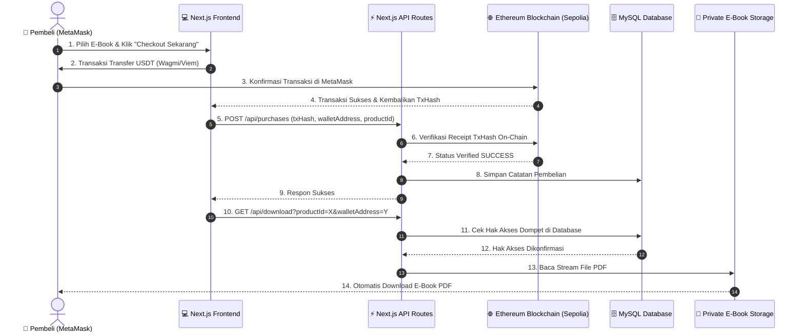

# BStore — Decentralized E-Book Platform

[](https://nextjs.org/)
[](https://www.typescriptlang.org/)
[](https://wagmi.sh/)
[](https://soliditylang.org/)
[](https://www.mysql.com/)
[](LICENSE)

> **BStore** adalah platform e-commerce e-book terdesentralisasi generasi baru yang memadukan performa **Next.js 14 App Router** dengan keamanan pembayaran **Web3 Smart Contract (USDT/USDC)** di atas jaringan blockchain multichain.

---

## 🌟 Mengapa BStore Unik? (Key Highlights)

* **🌐 Multi-Chain Web3 Payments:** Pembayaran instan menggunakan stablecoin (USDT / USDC) di Ethereum Mainnet, Sepolia Testnet, Polygon, Arbitrum, Optimism, dan BSC.
* **🛡️ Fraud-Proof On-Chain Verification:** Backend memverifikasi tanda tangan transaksi (*txHash*) secara real-time langsung ke node blockchain sebelum memberikan akses unduhan.
* **🔒 Protected E-Book Streaming System:** File fisik PDF disimpan di folder privat terisolasi (di luar `/public`) dan di-stream secara aman hanya untuk dompet terverifikasi di MySQL database.
* **⚙️ Interactive Admin Dashboard:** Dilengkapi dengan analisis ulasan, manajemen produk, dan badge *Transaction Hash* yang langsung terhubung ke **Etherscan**.
* **💎 Sci-Fi Glassmorphism UI:** Desain antarmuka modern dengan mode gelap, animasi mikro, dan UI/UX interaktif berbasis CSS variables kustom.

---

## 🏗️ Arsitektur Sistem (System Architecture)



---

## 🚀 Fitur Utama (Core Features)

### 🛒 1. Shopping Cart & Web3 Checkout
- Keranjang belanja interaktif dengan kalkulasi instan.
- Deteksi otomatis jaringan dompet (Sepolia, Arbitrum, Polygon, dll).
- Integrasi dompet modern via **RainbowKit & Wagmi**.
- Proteksi harga dengan konversi desimal token presisi tinggi.

### 🔐 2. Sistem Unduhan Terproteksi
- Menolak akses (*403 Forbidden*) jika dompet belum memiliki riwayat transaksi terverifikasi di MySQL.
- Mencegah kebocoran tautan dan unduhan ilegal secara otomatis.

### 📊 3. Admin Dashboard & Verifikasi Ulasan
- Kelola katalog produk e-book (Tambah, Edit, Hapus).
- Pantau ulasan pembeli terverifikasi beserta link bukti **Transaction Hash** ke Etherscan.
- Proteksi sesi admin menggunakan **JWT Token & Web Crypto API**.

---

## 🛠️ Teknologi & Stack (Tech Stack)

| Kategori | Teknologi Yang Digunakan |
| :--- | :--- |
| **Frontend Framework** | Next.js 14 (App Router), React 18, TypeScript |
| **Styling & Theme** | Vanilla CSS3 (Sci-Fi Glassmorphism System), CSS Variables |
| **Web3 Libraries** | Wagmi v2, Viem, RainbowKit, Ethers.js |
| **Smart Contracts** | Solidity 0.8.28, Hardhat, OpenZeppelin ERC-20 |
| **Database** | MySQL (Connection Pooling via `mysql2/promise`) |
| **State Management** | React Query (TanStack Query v5), React Context API |
| **Security & Auth** | Web Crypto API (`crypto.subtle`), JWT, HTTP-Only Cookies |

---

## ⚙️ Panduan Instalasi & Memulai (Getting Started)

### 1. Kloning Repository
```bash
git clone https://github.com/username-anda/my-ebook-store.git
cd my-ebook-store
```

### 2. Install Dependensi
```bash
npm install
```

### 3. Konfigurasi Environment Variables (`.env.local`)
Buat file `.env.local` di root folder proyek Anda:

```env
# Database MySQL
DB_HOST=localhost
DB_PORT=3306
DB_USER=root
DB_PASSWORD=password_mysql_anda
DB_NAME=my_ebook_store

# Web3 & Merchant
NEXT_PUBLIC_MERCHANT_ADDRESS=0x71C7656EC7ab88b098defB751B7401B5f6d8976F
NEXT_PUBLIC_WALLET_CONNECT_PROJECT_ID=wallet_connect_project_id_anda
SEPOLIA_RPC_URL=https://rpc.ankr.com/eth_sepolia

# Auth & Secrets
ADMIN_SESSION_SECRET=rahasia_super_aman_jwt_admin_anda
```

### 4. Jalankan Server Dev
```bash
npm run dev
```
Buka [http://localhost:3000](http://localhost:3000) di browser Anda.

---

## 📄 Smart Contract Info

- **Token Name:** Mock Tether USD (`MockUSDT`)
- **Sepolia Testnet Contract Address:** [`0x6b25442abad6c9a19616d8e5e1b6b7c3a772dc23`](https://sepolia.etherscan.io/address/0x6b25442abad6c9a19616d8e5e1b6b7c3a772dc23)
- **Decimals:** 6

---

## 👨‍💻 Author & Creator

* **Developer:** [Nama Anda](https://github.com/username-anda)
* **Contract Deployer Wallet:** `0x47a...6dbd5`
* **License:** [MIT License](LICENSE)

---

<p align="center">
  <i>Developed with ❤️ for the Web3 & Open-Source Community</i>
</p>
